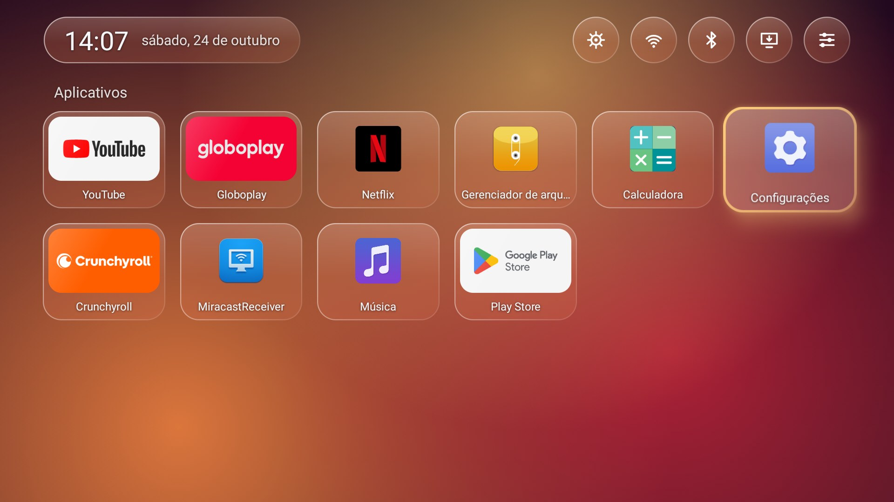
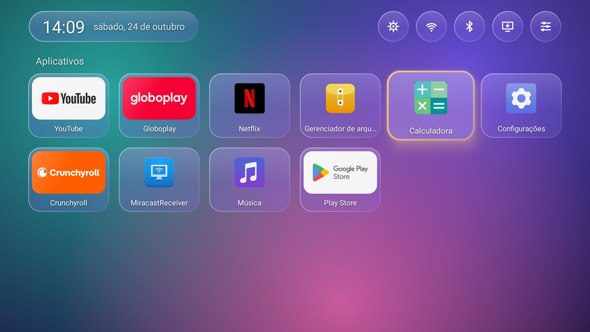
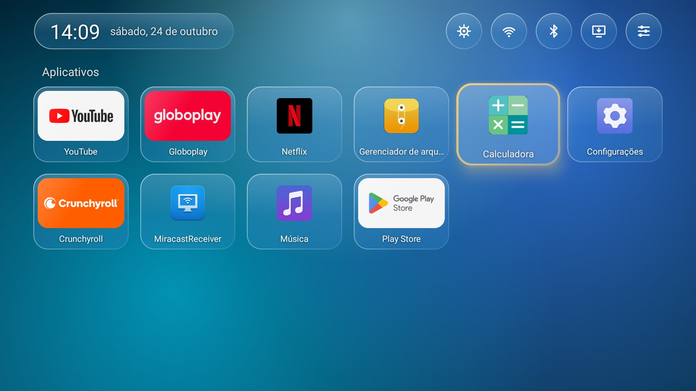
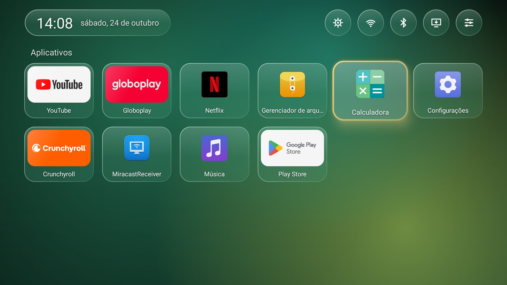
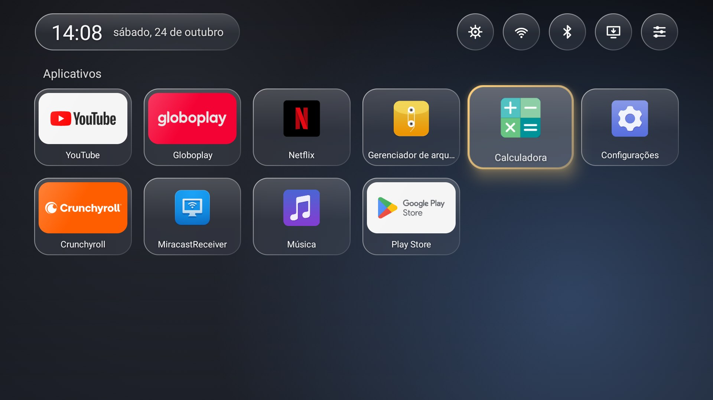
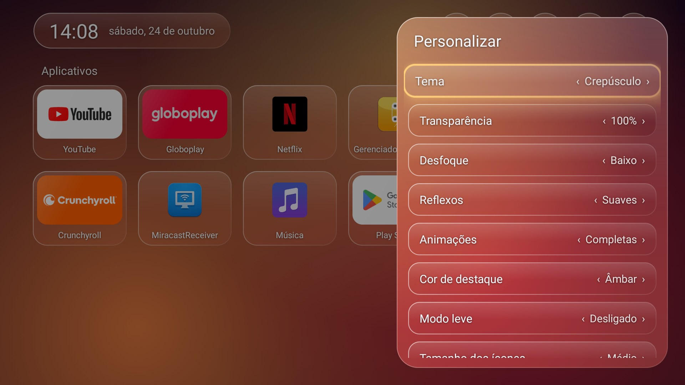
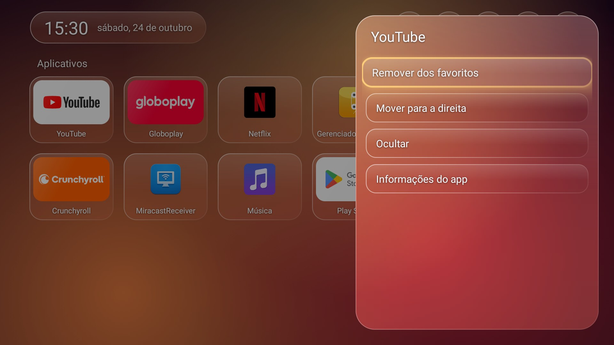
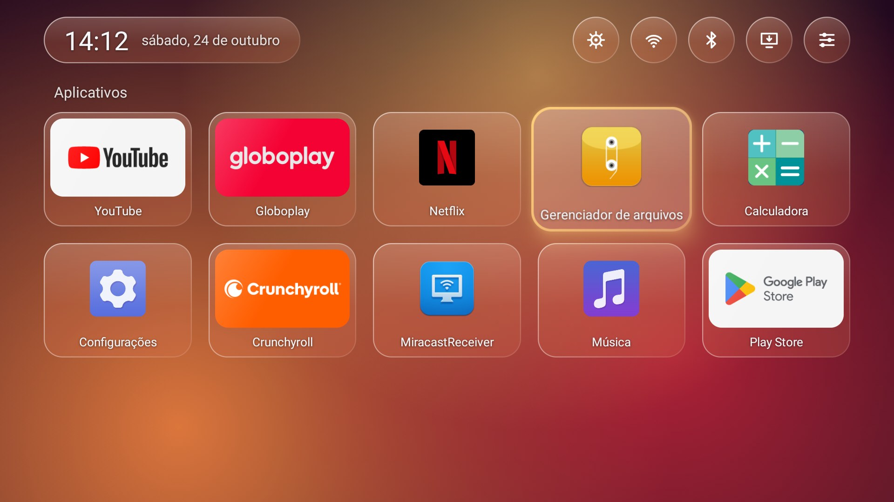
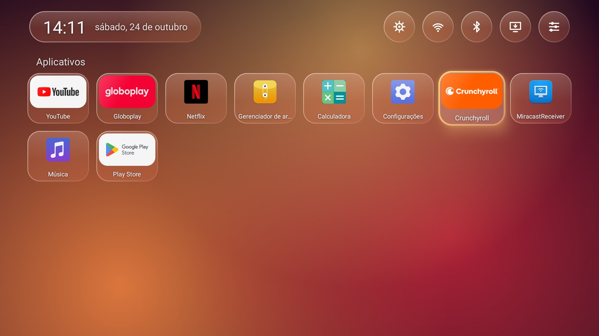

# HY320 Launcher

Tela inicial leve, sem propaganda e com visual de "vidro líquido" para o **projetor HY320** (Android TV 11), mais a solução para dois problemas comuns do aparelho: o [**controle remoto pulando/repetindo teclas**](#controle-remoto-do-hy320-pulando-repetindo-ou-travando-veja-a-solução) e o [**pendrive não reconhecido**](#pendrive-não-aparece-no-hy320-usb-não-reconhece).



> *English summary at the end.*

## Por que existe

A tela inicial original do HY320 ocupa ~96 MB de RAM, num aparelho com menos de 1 GB, e mostra propaganda. Com pouca memória, o sistema trava e "dispara" as setas do controle: o cursor pula vários ícones de uma vez. Este launcher:

- é leve: APK de ~320 KB, sem WebView nem bibliotecas pesadas;
- tem um **Filtro do controle** que descarta as setas que chegam atrasadas quando o sistema trava;
- traz um script que desliga, só com a sua permissão, o que mais pesa no aparelho (telemetria, propaganda, cliques sonoros, HDMI-CEC);
- corrige a porta USB, que vem de fábrica sem reconhecer pendrives depois do boot.

Tudo funciona **sem root** e pode ser desfeito.

## Controle remoto do HY320 pulando, repetindo ou travando? Veja a solução

**Sintomas:** você aperta a seta uma vez e o cursor anda 3, 5 ou 10 itens. As teclas "travam" e depois disparam todas de uma vez. A lista rola sozinha, o controle parece ter vontade própria. Acontece no menu inicial, nas Configurações (lista de fuso horário), no YouTube etc.

**Não é defeito do controle nem do receptor IR.** Medimos com o ADB: cada toque chega limpo, sem repetição. O problema está no sistema do projetor. Com pouca memória (menos de 1 GB), ele fica ocupado e segura as teclas na fila. Quando libera, entrega tudo junto, e o Android ainda cria repetições falsas porque o "soltar a tecla" chegou atrasado.

O que deixava o sistema ocupado, em ordem de importância:

1. **Keystone automático (correção de trapézio automática).** Mesmo com o projetor parado, ele recalcula o ângulo ~2 vezes por segundo. **Desligue em Configurações → Projeção** (a tela de keystone/trapézio do projetor). Só isso já resolve a maior parte do problema, mesmo sem instalar este launcher.
2. **Som de clique das teclas.** Cada tecla toca um som do sistema. Desligue os sons do sistema nas Configurações, ou pelo ADB: `adb shell settings put system sound_effects_enabled 0`.
3. **HDMI-CEC.** O projetor consulta a porta HDMI a cada 30 s, e cada consulta falha em ~200 ms. Pelo ADB: `adb shell settings put global hdmi_control_enabled 0`.
4. **Launcher original, telemetria e loja da HTC.** Ocupam memória o tempo todo. O instalador deste projeto pode desativá-los (com a sua permissão).

**Resultado medido** (mesmo teste, com o controle de verdade):

| Medida | Antes | Depois |
|---|---|---|
| Setas atrasadas | 36 | **0** |
| Rajadas (disparos) | 2 | **0** |
| Travadas acima de 0,4 s | 1 (até 1,4 s) | **0** |

Como rede de segurança, o **Filtro do controle** deste launcher descarta as setas que chegam atrasadas, em qualquer app.

## Pendrive não aparece no HY320? (USB não reconhece)

Se o pendrive não aparece no gerenciador de arquivos, nem mesmo reiniciando com ele conectado: a porta USB do HY320 vem configurada de fábrica para mudar para "modo dispositivo" ~18 s depois de ligar, e o pendrive desconecta. Formatar em FAT32 ou exFAT não adianta. A correção, sem root, é um comando ADB seguido de reiniciar:

```sh
adb shell setprop persist.sys.usb0device 0
adb reboot
```

Para desfazer: `adb shell setprop persist.sys.usb0device 1`. O instalador oferece essa correção.

## Recursos

| | |
|---|---|
| **5 temas de cores** | Aurora, Oceano, Crepúsculo, Floresta e Grafite. O tema colore o vidro, mesmo com uma imagem sua no fundo. |
| **Imagens próprias** | Use qualquer JPG ou PNG como fundo. Coloque as imagens em `Pictures/Wallpapers` ou numa pasta `Wallpapers` no pendrive: elas são copiadas sozinhas ao conectar. |
| **Vidro inteligente** | Em fundos claros, o vidro escurece sozinho para o texto continuar legível. |
| **4 tamanhos de ícone** | Grande, Médio, Pequeno e Mínimo (5 a 8 colunas). |
| **Favoritos e Recentes** | Prateleiras opcionais (desligadas por padrão). |
| **Organização** | Segure **OK** num app (ou aperte **Menu**) para favoritar, mover, ocultar ou ver as informações. |
| **Ajustes do vidro** | Transparência, desfoque, reflexos, animações, cor de destaque e um Modo leve sem desfoque. |
| **Atalhos** | Configurações, Wi-Fi, Bluetooth e Entradas (HDMI) no topo da tela. |

| Temas | |
|---|---|
|  |  |
|  |  |

| Personalizar | Opções de um app |
|---|---|
|  |  |

| Ícones grandes | Ícones mínimos |
|---|---|
|  |  |

## Instalação

Você vai precisar de um computador na mesma rede Wi-Fi do projetor.

### 1. Ligue a depuração por rede (ADB) no projetor

1. Abra **Configurações → Preferências do dispositivo → Sobre** e clique **7 vezes** em **Build** até aparecer "Você agora é um desenvolvedor".
2. Volte e abra **Opções do desenvolvedor**. Ligue a **Depuração USB** (ou **Depuração por rede/ADB**).
3. Anote o **IP** do projetor: **Configurações → Rede e Internet → (sua rede)**.

> Os nomes dos menus podem variar um pouco entre versões do firmware.

### 2. Baixe os arquivos

Na página [**Releases**](../../releases/latest), baixe o `hy320-launcher-instalador-*.zip` e descompacte numa pasta.

Também é preciso o **ADB**: baixe o [SDK Platform-Tools](https://developer.android.com/tools/releases/platform-tools) e coloque o `adb.exe` (com os arquivos `AdbWinApi.dll` e `AdbWinUsbApi.dll`) na mesma pasta.

### 3. Rode o instalador

- **Windows:** clique duas vezes em `instalar.bat`.
- **Linux/macOS:** `sh instalar.sh`

O instalador pede o IP do projetor, instala o launcher, concede as permissões e o define como tela inicial. Depois, **pergunta um por um** os ajustes opcionais. Todos vêm desligados até você responder `s`. Os valores originais ficam anotados em `alteracoes.txt`; guarde esse arquivo para poder desfazer.

Na primeira conexão, o projetor pergunta "Permitir depuração?": escolha **Permitir** e marque **Sempre**.

### 4. Desligue o keystone automático (recomendado)

Esta é a dica mais importante: nas configurações de **Projeção** do projetor, desligue a **correção automática de trapézio (keystone)**. Mesmo com o projetor parado, ela gera 2 eventos por segundo que competem com as teclas do controle. Foi a principal causa dos "pulos" do cursor nos testes. O script não consegue mudar isso; é preciso fazer pelo menu.

## O que o instalador muda

| Ajuste | Por quê | Obrigatório |
|---|---|---|
| Instala `dev.hy320.launcher` e o define como tela inicial | É o launcher | Sim |
| Permissão de ler imagens | Para usar suas imagens como fundo | Sim |
| Permissão `WRITE_SECURE_SETTINGS` | O app de Configurações da HTC desliga os serviços de acessibilidade ao abrir Data/hora e Idioma; o launcher religa o Filtro do controle sozinho. Escreve só as duas chaves de acessibilidade. | Sim |
| Desliga o som de clique (`sound_effects_enabled`) | Cada clique carrega o sistema e atrasa as teclas | Não |
| Desliga o HDMI-CEC (`hdmi_control_enabled`) | O projetor consulta o HDMI a cada 30 s, e cada consulta falha em ~200 ms | Não |
| `persist.sys.usb0device` de `1` para `0` | De fábrica, ~18 s após ligar, a porta USB muda para "modo dispositivo" e o pendrive desconecta. Com `0`, ela fica em modo host e os pendrives funcionam. | Não |
| Desativa `com.htc.eventuploadservice` | Telemetria | Não |
| Desativa `android.rockchip.update.service` e `com.htc.htcotaupdate` | Atualizadores do sistema. Uma atualização pode desfazer tudo e reinicia o aparelho sozinha. | Não |
| Desativa `com.htc.storeos` | Loja e propaganda | Não |
| Desativa `com.htc.htclauncherhighenglishd08` | Launcher original (~90 MB de RAM) | Não |

**Nunca desative** o `com.htc.closedialog`: ele cuida de temperatura, foco e controle remoto.

## Como desfazer

Rode `desfazer.bat` (Windows) ou `sh desfazer.sh`, na mesma pasta onde está o `alteracoes.txt`. Ele pergunta passo a passo: reativar os apps, religar som e HDMI-CEC, voltar a porta USB e remover o launcher, voltando à tela inicial original. Sem o `alteracoes.txt`, ele usa os valores de fábrica do HY320.

Manualmente, pelo ADB:

```sh
adb shell pm enable <pacote>                         # reativa um app
adb shell settings put system sound_effects_enabled 1
adb shell settings put global hdmi_control_enabled 1
adb shell setprop persist.sys.usb0device 1
adb shell cmd package set-home-activity com.htc.htclauncherhighenglishd08/com.htc.activity.HomeActivity
adb uninstall dev.hy320.launcher
```

## Uso

- **Setas e OK**: navegar e abrir.
- **Segurar OK** ou **Menu** num app: favoritar, mover, ocultar e ver as informações.
- **Personalizar** (último botão no topo): tema, vidro, tamanho dos ícones, prateleiras, Filtro do controle, apps ocultos e imagens próprias.
- **Imagens próprias**: copie JPG/PNG para `Pictures/Wallpapers` no projetor, ou crie uma pasta `Wallpapers` na raiz de um pendrive. Ao conectar, as imagens novas são copiadas e aparecem na lista. Imagens com o mesmo nome nunca são sobrescritas.

## Observações técnicas

Coisas descobertas durante o desenvolvimento que podem ajudar outros donos do HY320 (Allwinner H713, `sun50iw12p1`, Android 11, 32-bit):

- **Pendrive não reconhecido:** `persist.sys.usb0device=1` faz o `init` (`/vendor/etc/init/hw/init.sun50iw12p1.usb.rc`) colocar a porta OTG `usbc0` em modo dispositivo depois do boot. O pendrive é detectado e cai em seguida. `setprop persist.sys.usb0device 0` resolve sem root.
- **Cursor pulando:** o controle e o receptor IR estão limpos (todo DOWN tem UP em menos de 300 ms). O atraso nasce no `system_server`, quando ele está ocupado com o keystone automático, os sons de clique e o polling do HDMI-CEC. Quando a fila é liberada, o Android gera repetições falsas.
- **Pasta do pendrive vazia para apps:** no Android 11, listar a pasta do pendrive pelo caminho retorna 0 arquivos para apps. O launcher usa o `MediaStore` do volume.
- **`pm disable-user` seguido de reboot imediato perde a mudança:** espere ~15 s antes de reiniciar.
- **Desfoque sem `RenderEffect`** (API 31+): o fundo é reduzido para 1/8, desfocado uma vez e tingido. Cada superfície de vidro desenha o recorte correspondente à sua posição.

## Compilar

Requisitos: JDK 17 e Android SDK (platform 34, build-tools 34).

```sh
./gradlew assembleRelease     # app/build/outputs/apk/release/app-release.apk
```

Sem um `keystore.properties` na raiz, a release é assinada com a sua chave de debug. Para usar uma chave própria, crie o arquivo:

```properties
storeFile=C:/caminho/release.jks
storePassword=...
keyAlias=...
keyPassword=...
```

Um APK assinado com outra chave não instala por cima do oficial: desinstale antes.

## Aviso

Projeto independente, sem relação com a HTC ou com o fabricante do projetor. Testado num HY320 com firmware `ADT-3 ... eng.projector.20241225`. Use por sua conta e risco. Tudo é reversível, mas uma atualização do sistema pode desfazer os ajustes.

## Licença e créditos

[MIT](LICENSE). Criado por **Claudio Segura Psicologia e Tecnologia Ltda**, feito com Claude Opus 5.5.

---

## English summary

A lightweight, ad-free "liquid glass" home screen for the **HY320 projector** (Android TV 11, Allwinner H713). It is small (~320 KB APK) and lets you disable the stock launcher (~96 MB of RAM). Features: 5 color themes, your own wallpapers (auto-imported from a `Wallpapers` folder on a USB drive), 4 icon sizes, and a remote-control filter that drops late D-pad presses.

The installer (`instalar.bat` / `instalar.sh`, needs ADB over Wi-Fi, no root) asks before every optional tweak: disabling telemetry, OTA and ads, turning off click sounds and HDMI-CEC, and `setprop persist.sys.usb0device 0`. That last one is the fix for USB drives disconnecting ~18 s after boot. Everything can be undone with `desfazer.bat` / `desfazer.sh`. Also turn off auto-keystone in the projector's Projection settings: it is the main cause of the cursor "jumping". UI is in Portuguese.

**HY320 remote control jumping, lagging or repeating keys?** It is not the remote: the system stalls (low RAM) and releases queued key presses in a burst. Turn off **auto-keystone** (Projection settings), then system click sounds (`settings put system sound_effects_enabled 0`) and HDMI-CEC (`settings put global hdmi_control_enabled 0`). In our measurements this took late key presses from 36 to 0.

**HY320 USB drive not detected?** Run `adb shell setprop persist.sys.usb0device 0` and reboot. The factory setting switches the USB port to device mode ~18 s after boot.
